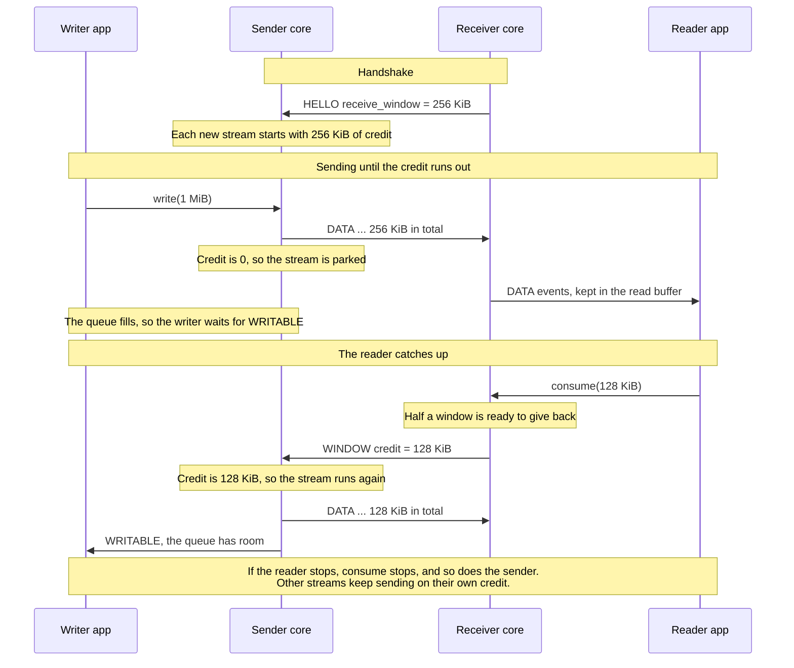
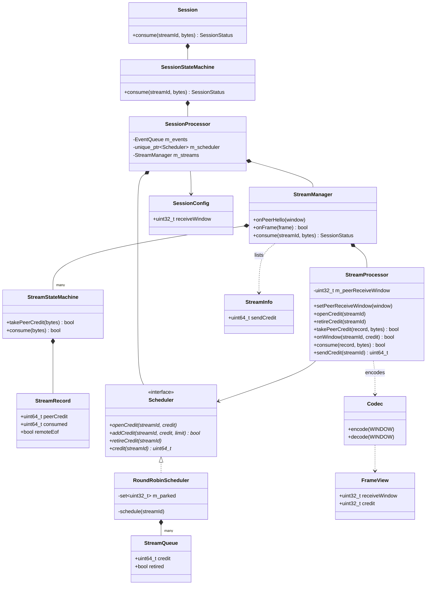

# M11 — Credit flow control: design

Status: implemented. The removal check in §8 runs with the final testing pass. Plan: `docs/requirements/IMPROVEMENTS.md`, requests 1, 2, 6 and 14. Evidence:
`docs/design/M10_MEASUREMENTS.md`.

A receiver lets its peer send only what its consumer has room for, per stream. A stalled reader then
stalls only its own stream, memory stays bounded, and the 2.6 MB kernel queue behind a bulk transfer
goes away.

This changes the wire inside v2, which is unreleased (D8). All peers upgrade together.

## How it works

Think of credit as an allowance. The receiver says "you may send me 256 KiB on this stream". The sender
spends the allowance as it sends, and stops when it runs out. Each time the receiver's application
reads the data, that space is free again, so the receiver tops the allowance back up.

The important part is when the top-up happens: after the application has read the data, not when it
arrives. An application that stops reading stops the top-ups, so the sender stops too, with at most one
allowance of data waiting. Nothing can pile up beyond that.

Each stream has its own allowance. One stalled stream runs out and waits, and the others carry on. Those
streams all share one connection, which is why TCP alone cannot do this: slowing the connection would
slow every stream.

To avoid one small frame per read, the receiver saves up its top-ups and sends one when it has half an
allowance to give back. `WINDOW` is the name of the top-up frame.



## 1. Decisions

| # | Decision | Why |
|---|---|---|
| 1 | `WINDOW` frame, value 11, carries `credit u32` on one stream | Same as native |
| 2 | Each side announces `receive_window` in `HELLO`, for all its streams | No `OPEN` or `OPEN_OK` change, and no per-stream tuning that nothing needs |
| 3 | Default `receive_window` is 256 KiB, configurable | M10 |
| 4 | The window is fixed for a connection | Keeps the rule "credit never exceeds the window", which catches a broken peer. Growing it later needs a protocol change |
| 5 | Credit lives in the core, and the host reports what its consumer took with one new call | The SDK already has one path out of the read buffer (FR-AST-7), and every language gets the logic once |
| 6 | The sender sends whole frames, capped at half the peer's window | Prevents the M10 deadlock with no splitting at send time (§3.3) |
| 7 | `max_read_buffer` and its reset are removed (D17 retired) | Credit bounds the buffer, so a stalled reader waits instead of losing its stream |
| 8 | `max_queued_bytes` default rises from 1 MiB to 16 MiB | Stalled streams keep their queues. At 1 MiB, four of them would block writes on every other stream. 16 MiB is `max_streams` × 256 KiB |
| 9 | No connection-wide window | Same as native. N bulk streams can have N windows in flight |

## 2. Wire

```
HELLO   (1)   version u16 | resuming u8 | receive_window u32 | session_id id16 | capabilities bytes32
WINDOW  (11)  credit u32      stream_id ≠ 0
```

- `receive_window` MUST be at least 2. `credit` MUST be at least 1. Otherwise decoding fails.
- `DATA` payload bytes use credit. `EOF`, `RST` and control frames do not.
- A sender starts each stream with credit equal to the peer's `receive_window`, and may send `DATA`
  straight after `OPEN`, as it can today.
- A receiver MUST send `WINDOW` once it holds at least half of `receive_window` in bytes taken by its
  consumer and not yet granted. It sends all of them in one frame.

Two connection errors, both `PROTOCOL_ERROR`, because they mean the peer's accounting is broken:

- `DATA` beyond the credit the receiver has given.
- `WINDOW` that takes the sender's credit above the peer's `receive_window`.

`WINDOW` is a control frame, so it goes ahead of stream data. It goes to the scheduler, not to the
stream's state: a stream that has closed locally can still have data queued, and that data still needs
credit. With nothing left to send it is ignored, because it can cross with the close. The stream table
does not change.

A stream can be opened during the handshake, before the peer's window is known. A write then accepts
nothing, and the stream gets `WRITABLE` when `HELLO` arrives, so every frame is cut for the right window.

Streams end when a connection is lost, so credit never crosses a reconnect. The next `HELLO` may
announce a different window.

## 3. Core

### 3.1 Sending

Credit belongs to the scheduler, because it decides what can go next. A stream whose front frame does
not fit is parked, and leaves the round-robin order until a grant arrives.

```cpp
class Scheduler {
  virtual void openCredit(uint32_t i_streamId, uint64_t i_credit) = 0;
  // false: credit would go above i_limit, which is a connection error
  virtual bool addCredit(uint32_t i_streamId, uint64_t i_credit, uint64_t i_limit) = 0;
  // The stream closed. Frames still queued keep their credit, and go out.
  virtual void retireCredit(uint32_t i_streamId) = 0;
  virtual uint64_t credit(uint32_t i_streamId) const = 0;
  // the rest is unchanged
};
```

```python
def push_stream_frame(stream_id, message, data_bytes):
    queue = streams[stream_id]
    was_empty = not queue.frames
    queue.frames.append((message, data_bytes))
    if was_empty:
        schedule(stream_id)

def schedule(stream_id):                          # the only place that sorts order and parked
    queue = streams[stream_id]
    if queue.frames[0].data_bytes <= queue.credit:
        order.append(stream_id)
    else:
        parked.add(stream_id)

def pop():
    if control:
        return control.popleft()
    if not order:
        return None                               # parked streams wait for WINDOW
    stream_id = order.popleft()
    frame = streams[stream_id].frames.popleft()
    streams[stream_id].credit -= frame.data_bytes
    if streams[stream_id].frames:
        schedule(stream_id)
    return frame

def add_credit(stream_id, credit):
    streams[stream_id].credit += credit
    if stream_id in parked and front_fits(stream_id):
        parked.remove(stream_id)
        order.append(stream_id)
```

`StreamQueue` entries now live as long as the stream, since they hold its credit. When a stream closes,
`retireCredit` erases the entry, or marks it to go with its last frame. `dropStream` erases the entry and
clears it from `parked`. `empty()` counts parked streams as not empty.

An `EOF` has `data_bytes` 0, so it fits whenever it reaches the front.

### 3.2 Receiving

The stream gains `peerCredit`, `consumed` and `remoteEof`. The core still keeps no receive buffer.

```python
def on_data(record, data):                        # before delivering
    if len(data) > record.peer_credit:
        connection_error(PROTOCOL_ERROR)
        return
    record.peer_credit -= len(data)
    deliver(data)

def consume(stream_id, count):                    # the new host call
    record = find(stream_id)
    if record is None:
        return OK                                 # it closed first, which is normal
    if count > window - record.peer_credit - record.consumed:
        return INVALID_ARGUMENT                   # more than was delivered
    record.consumed += count
    if record.consumed >= window / 2 and not remote_eof(record):
        queue_control(WINDOW(stream_id, record.consumed))
        record.peer_credit += record.consumed
        record.consumed = 0
```

After the peer's `EOF` nothing more can arrive, so no grant is sent.

### 3.3 Why this cannot deadlock

Frames are cut at `write`, so the chunk size changes there, and nothing is split at send time:

```python
chunk = min(limits.max_data_payload, peer_receive_window / 2)
```

A stream is parked only when `credit < frame <= W / 2`. So more than `W / 2` bytes are in flight or held
by the receiver. Once the consumer has taken them, the receiver holds more than `W / 2` ungranted bytes
and MUST send `WINDOW`. Every parked stream therefore gets a grant unless its consumer stopped reading,
which is the point of the feature.

M10 recommended sending partial chunks. This cap gives the same safety with no change to how frames are
queued, so it replaces that recommendation.

### 3.4 Closing and limits

- `ClosingState` and `DrainingState` already drop stream queues, so a close never waits for credit.
- At most two `WINDOW` frames per stream can be queued while the peer is not reading, because nothing
  more can be consumed without new grants reaching it. The rule for `max_queued_control_frames` becomes
  a cap above 5 × `max_streams`. The default of 1024 passes.
- A writer on a stalled stream waits on `WRITABLE`, as it does for a full queue today.

### 3.5 Config and C ABI

```c
/* appended to packetmux_config_t */
uint32_t receive_window;                 /* default 256 KiB. At least 2 × max_data_payload */

/* appended to packetmux_stream_info_t */
uint64_t send_credit;

/* appended to packetmux_frame_t */
uint32_t receive_window;
uint32_t credit;

PACKETMUX_API packetmux_status_t packetmux_session_consume(
    packetmux_session_t* i_session, uint32_t i_stream_id, uint64_t i_bytes);
```

A sync binding consumer MUST call `consume` for the data it takes, or the stream stalls after one
window. `BINDING.md` level 1 states this.

### 3.6 Classes

M11 adds no new classes or files to the core. It adds members to existing ones, and the diagram shows
only those members, with `RoundRobinScheduler` and `StreamProcessor` doing most of the work.



| Change | Files |
|---|---|
| `WINDOW`, `HELLO.receive_window`, new fields | `include/packetmux/Frames.h`, `src/Codec.cpp` |
| Config, stream info, `consume` | `include/packetmux/SessionTypes.h`, `include/packetmux/Session.h`, `src/session/Session.cpp`, `src/session/SessionStateMachine.*` |
| Credit, parking | `src/session/Scheduler.h`, `src/session/RoundRobinScheduler.*` |
| Accounting, grants, chunk cap | `src/stream/StreamRecord.h`, `src/stream/StreamProcessor.*`, `src/stream/StreamManager.*` |
| Receive accounting | `src/stream/StreamStateMachine.*` |
| Handshake and errors | `src/session/SessionProcessor.cpp`, `src/session/state/EstablishedState.cpp` |
| C ABI | `include/packetmux/PacketMuxC.h`, `src/capi/PacketMuxC.cpp` |

## 4. SDK

The only new logic is one line in each language, in the path FR-AST-7 kept for it:

```python
def _take(self) -> bytes:
    chunk = self._read_buffer.popleft()
    self._read_bytes -= len(chunk)
    self._host.consume(self.id, len(chunk))       # may queue WINDOW, so it wakes the sender
    return chunk
```

`SessionHost.consume` goes through `_call`, and does nothing once the core is released. Bytes dropped by
a reset are never consumed, and need no grant because the stream has ended.

Removed from both SDKs: the `max_read_buffer` option, and the reset in `on_data`. `read_high_water` stays,
and can no longer exceed the window. `receive_window` is set through the existing `session` options.

Unchanged: `Stream.read`, `Stream.write`, handlers, and `inflight_limit`, which still bounds the buffer
above the kernel.

**Consumer change:** RemoteDevice drops its 1 GiB `max_read_buffer` setting, on its own branch.

## 5. Conformance

Every hard-coded `HELLO` changes again, in `frames.txt`, the sync scenarios and the test helpers.

| Layer | New coverage |
|---|---|
| Vectors | `WINDOW` round trip, `credit` 0, wrong length, `stream_id` 0, `HELLO` with `receive_window` below 2 |
| Sync | A sender stops at the window and resumes on `WINDOW`. Credit is per stream. A parked stream does not block others. `EOF` passes with no credit. `DATA` past credit and `WINDOW` past the window are connection errors. A grant comes at half a window, and not before. No grant after the peer's `EOF`. `consume` of a closed stream is `OK`, and of too many bytes is `INVALID_ARGUMENT`. `WINDOW` on a closed stream is ignored. A small peer window caps the chunk size |
| Async | A stalled reader leaves other streams working. A transfer many times the window completes. Five stalled streams do not block a sixth. A close finishes while streams are parked |

`read-buffer-limit-resets-only-that-stream` is replaced by the stalled reader scenario. `protocol_version`
stays 2. Three async scenarios wrote 1 MiB to an echo stream and read afterwards. With credit that waits
forever, as it should, so they now read during the write. The binding READMEs warn about this pattern.

## 6. Docs

| File | Change |
|---|---|
| `INTENT.md` | Replace FR-BP-3. New FR-FC requirements. Retire D17 with a new decision, and add D24 for credit in v2 and D25 for the window. Remove credit from §2.2 and two limitations from §8. Add request 14: browser transports cannot be paused, so credit is the only receive limit there |
| `PROTOCOL.md` | §2.3, a new flow control section, §5.3, §8, §9, and the `HELLO` examples |
| `BINDING.md` | Level 1 `consume`, level 2 reading |
| `ROADMAP.md` | Remove §4, and drop the credit caveat in §3 |
| Binding READMEs | Remove `max_read_buffer` and "Keep reading", and describe `receive_window` |

## 7. Order of work

1. Spec and requirements.
2. Codec and vectors.
3. Scheduler and stream accounting, with C++ scenarios.
4. C ABI and both bindings.
5. Both SDKs, with the async scenarios.
6. Repeat the M10 latency and device runs once, and record the result in M10's note.

## 8. Exit criteria

- All conformance layers pass in C++, Python and TypeScript.
- Python ↔ TypeScript passes over a real WebSocket in both directions.
- A stalled reader leaves other streams running, with memory bounded by the window and queue limits.
- `adb push` of 200 MB through the tunnel passes with default settings, and `read_high_water` stays
  within the window.
- Loopback round trip beside a download is 1.0 ms or less, and throughput is not below native.
- Injected bugs in the credit logic are caught, in the final testing pass.

## 9. Risks

- **256 KiB limits a long path:** a stream's speed is capped at window / round trip, which is 12.8 MB/s
  at 20 ms and 2.6 MB/s at 100 ms. Native has the same cap, so this matches `main`, but it is lower than
  the integration branch today. WebRTC should be rechecked by RemoteDevice.
- **M10's window numbers were simulated:** the real result can differ, so the default is confirmed in
  step 6.
- **Upload was not simulated:** the same mechanism applies, and step 6 measures it.
