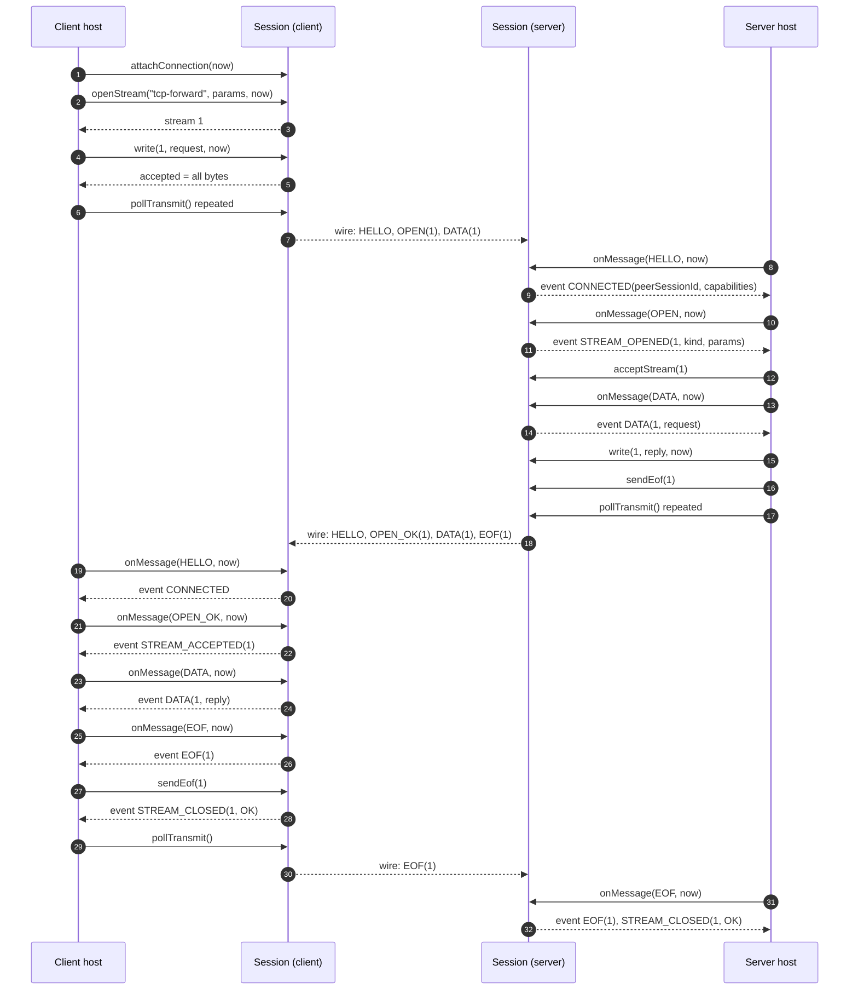
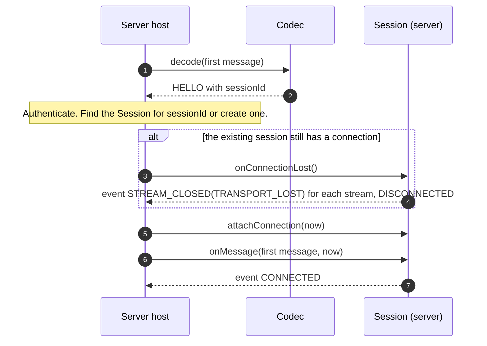
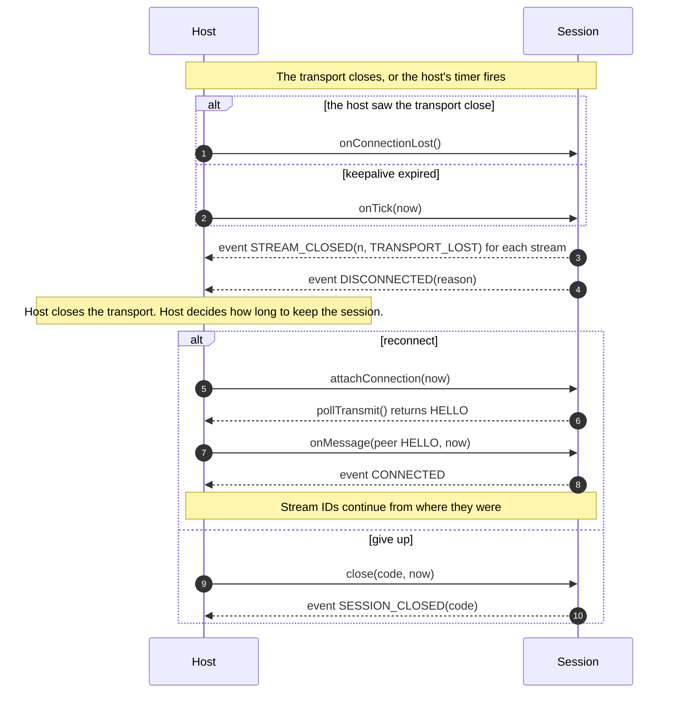
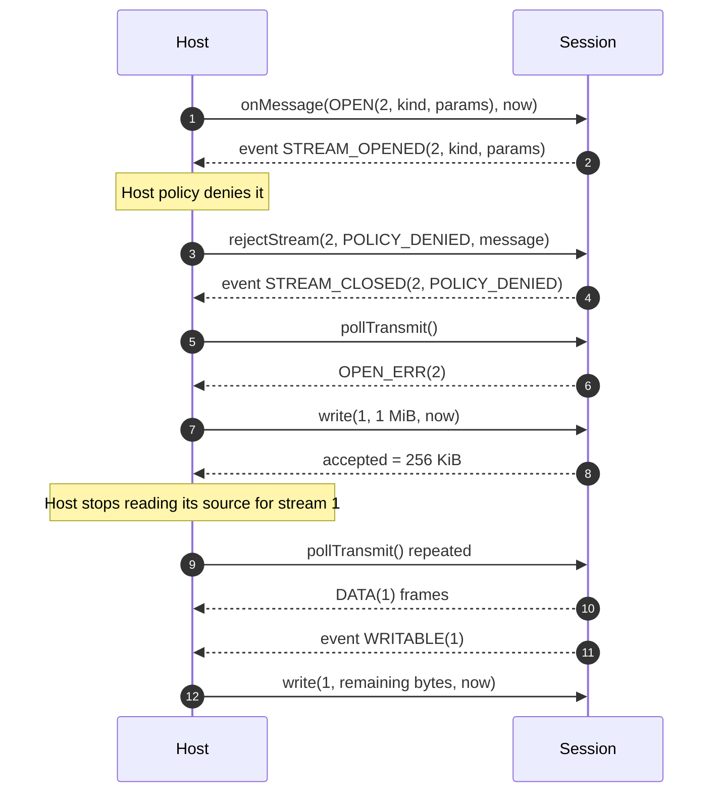
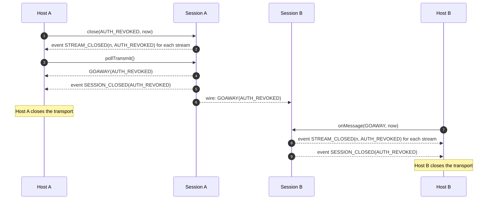
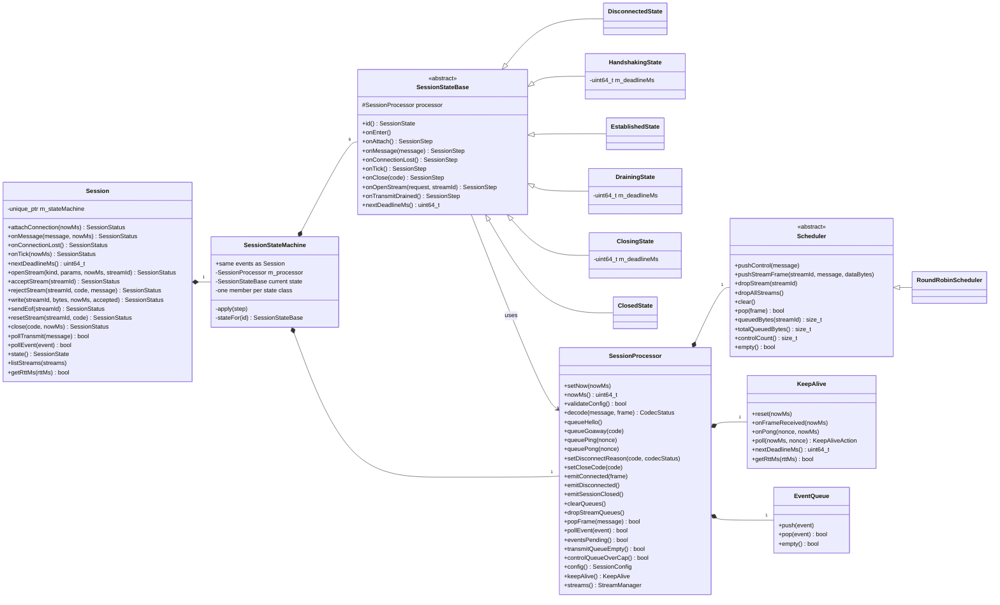
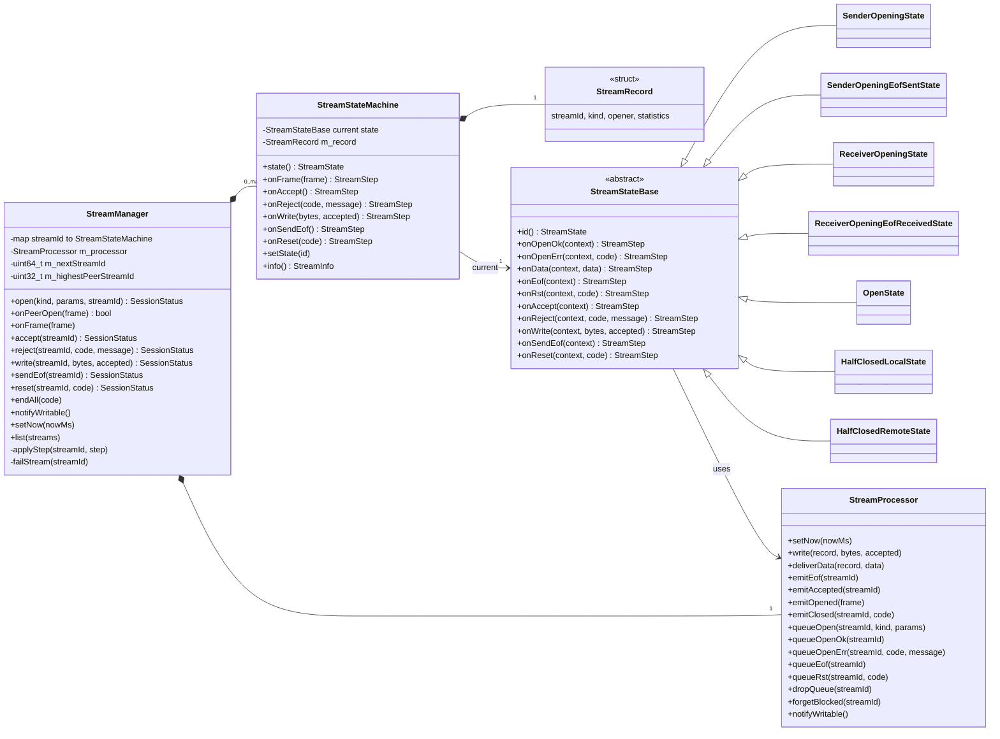

# M2 — Stream and session core: design

Status: implemented. Exit criteria met on macOS arm64 with Apple Clang 17 (§8).
Requirements: `docs/requirements/INTENT.md` (FR-HS-\*, FR-STR-\*, FR-SCH-\*, FR-BP-\*, FR-KA-\*,
FR-SES-\*, FR-ERR-\*, FR-API-1/2/3/5/6/7, NFR-CON-\*, NFR-SEC-1/2, NFR-MNT-4).
Builds on: `docs/design/M1_FRAME_CODEC.md`.

**Review §7 first.** It lists seven places where INTENT.md is wrong or incomplete. The rest of this
document already assumes those changes.

**Architecture in one line:** both state machines use the State pattern. Each state is a class that
owns its own logic, handlers return the next state, and a state machine class applies it.

Not in M2: the C ABI (M3), bindings (M4), the length-prefix framer and fuzzing (M5).

## 1. State machines

### 1.1 Session (connection lifecycle)

The session states, the transition table and their rules now live in `docs/spec/PROTOCOL.md` §4. The
table is the specification for the state classes in §5.2, and the test oracle for
`SessionLifecycleTest`. `T1` to `T9` below are the transitions in the spec's diagram.

### 1.2 Stream

The stream states, the transition table and the closing rules now live in `docs/spec/PROTOCOL.md` §5.
The table is the specification for the stream state classes in §5.5, and the test oracle for
`StreamStateMachineTest`. `S1` to `S13` below are the transitions in the spec's diagram.

The design reasoning stays here:

- There are no role checks and no "has the open finished?" flags. Opening is split by side, because
  the two sides accept completely different inputs while opening, so they share no opening state.
- The two `_EOF_` states exist because `adb` half-closes right after its request, so `EOF` can pass the
  end of opening. Without them, `HALF_CLOSED_LOCAL` would mean two different things depending on a
  hidden flag.
- The sender and receiver rows have no valid input in common except `RST` and reset, so their logic
  lives in different classes: only sender states implement `onOpenOk` and `onOpenErr`, and only
  receiver states implement `onAccept` and `onReject`.

### 1.3 State machine audit

I checked everything else that behaves like a state machine for the same problem: one state or one
function quietly doing different jobs through a branch. F1–F4 and F9 are fixed by this design.

| # | Where | Finding | Proposal | Status |
|---|---|---|---|---|
| F1 | `m_blockedStreams` | **Bug.** A stream blocked on `write` could then `sendEof`, and the host would still get `WRITABLE` for a stream it can no longer write to | Remove the stream from the list on `sendEof` | Fixed in `StreamProcessor::queueEof` (§5.5) |
| F2 | `Session` public methods | The same smell as `OPENING`. `onTick`, `close`, `onMessage`, `onConnectionLost` and `popFrame` each branch on `m_state`. Examples: `close` has "state was `DRAINING`, keep the `GOAWAY`", `popFrame` has "`DRAINING` or `CLOSING` → T5 or T7", and every method starts with early returns | One class per state. Every state must implement every event (pure virtual), so the compiler flags any case left out | Fixed: §1.1 table, §5.2 |
| F3 | `queuePeerDrivenControl`, `handleOpen` | Transitions hidden inside helpers. A handler can end the whole connection halfway through, which erases the stream it is working on. That is why `failStream` needs a "must be last" ordering rule, and it is easy to break | Handlers return the next state, and only the state machine applies it. The control cap is checked once, at the end of `EstablishedState::onMessage`, so the ordering rule is gone | Fixed: §5.1, §5.2 |
| F4 | `KeepAlive` | A hidden running/stopped state that duplicates "`m_state` is `ESTABLISHED`". Two sources of truth can disagree | No `stop()`. `EstablishedState::onEnter` calls `reset(now)`, and only `EstablishedState` ever uses it | Fixed: §5.2 |
| F9 | `StreamProcessor::dropQueue` | **Bug, found in code review during M2.** `WRITABLE` was only checked after a `DATA` frame left. Dropping a full stream's queue freed the room silently, so a stream blocked on the session limit waited forever | `dropQueue` also calls `notifyWritable` | Fixed (§5.6) |
| F5 | Clean-closed stream with frames still queued | A hidden "flushing" state: the stream is gone but its frames are not | No change. Nothing can reach it (its ID is unknown, so frames are ignored) and no code branches on it. It is documented in §1.2 | Accepted |
| F6 | `m_blockedStreams` | "Write-blocked" is a flag alongside the stream state | No change after F1. It does not depend on the stream state; it only depends on queue room | Accepted |
| F7 | `DISCONNECTED` | Covers both "never connected" and "connection lost" | No change. No behaviour differs between the two | Accepted |
| F8 | `EVENTS_PENDING` | Checked in every state before `onMessage` | No change. It is a precondition on the host, not a state | Accepted |

## 2. Sequence diagrams

These show only the boundary API. `wire` stands for whatever transport the host uses; its only
contract is reliable, ordered, whole messages. Every diagram assumes the host's loop:
- after each call, repeat `pollEvent` until empty and `pollTransmit` while the transport has room,
  until neither returns anything. `pollTransmit` can itself produce events (`WRITABLE`,
  `DISCONNECTED`, `SESSION_CLOSED`);
- then re-read `nextDeadlineMs()` and set one timer.

### 2.1 Connect, open a stream, transfer, close cleanly

The server host's `attachConnection` is left out here; §2.2 shows it.



### 2.2 Server binds a new transport to a session

A server does not know which `Session` a new transport belongs to until the client's first message
arrives. The host reads that message with the public `Codec`, finds or creates the session, and
feeds it the same message.



The `onConnectionLost` branch matters. A client that re-dials usually gets there long before the
server's `dead_after` fires, so the old connection still looks alive. `attachConnection` refuses
while a connection is attached (FR-SES-1), so the host retires the old one first.

### 2.3 Connection lost, then reconnect



### 2.4 Inbound rejection and write backpressure



### 2.5 Ending a session



## 3. Class diagram

### 3.0 How the pieces fit

```
Session  ──owns──▶ SessionStateMachine ──owns──▶ one instance of each session state
(public API)        (dispatch, transitions)  └──▶ SessionProcessor (one, shared by all states)
                                                   ├─ Scheduler, KeepAlive, EventQueue
                                                   └─ StreamManager ──owns──▶ StreamStateMachine (one per stream)
                                                      └─ StreamProcessor (one, shared by all streams)
```

Four rules keep this design honest:

1. **A state never switches state itself.** Every handler returns a step that names the next state,
   and only the state machine applies it, after the handler has returned. A state that switched
   directly could destroy itself while still running. This rule is also what fixes F3.
2. **Only state machines create states.** Constructors are private, with the state machine as
   `friend`. A `SessionStateMachine` holds one instance of each session state, so a transition never
   allocates. Stream states hold no per-stream data, so there is one `const` instance of each per
   process, private to `StreamStateMachine`. Being constant, they are not shared mutable state
   (FR-API-6).
3. **Decisions live in states, verbs live in processors.** A processor offers actions such as
   `queueGoaway` and `emitDisconnected`. It never sees the current state and never decides what
   should happen next. Without this rule, the processor becomes the giant class we are avoiding.
4. **Branching on the input inside a state is fine.** `EstablishedState::onMessage` has a `switch` on
   frame type. What this design removes is branching on the *state*.

The public `SessionState` and `StreamState` enums stay, but only as labels for `state()` and
`StreamInfo`. Nothing in the transition logic branches on them.

### 3.1 Session side



### 3.2 Stream side



How the two bases differ on purpose:
- `SessionStateBase` is **pure virtual**. Each session state does something different, so each must
  answer every event.
- `StreamStateBase` has **defaults**. 36 of the 70 table cells are invalid, and `RST` and reset behave
  the same in all seven states. So the base answers those 50 cells, and the states only override the
  20 cells that differ.

`Session.h` forward-declares `SessionStateMachine`, so nothing internal shows in a public header
(FR-API-7). `SessionStateBase` is not called `SessionState`, because that name is the public enum.

### 3.3 Public data types (`SessionTypes.h`)

```cpp
enum SessionStatus : uint8_t {
  SESSION_STATUS_OK = 0U,
  SESSION_STATUS_CLOSED,             // the session has ended
  SESSION_STATUS_NOT_CONNECTED,      // no connection attached
  SESSION_STATUS_ALREADY_CONNECTED,  // attachConnection while one is attached
  SESSION_STATUS_EVENTS_PENDING,     // onMessage before pollEvent was drained
  SESSION_STATUS_UNKNOWN_STREAM,
  SESSION_STATUS_INVALID_STATE,      // e.g. write after sendEof, or acceptStream twice
  SESSION_STATUS_LIMIT_EXCEEDED,     // max_streams reached
  SESSION_STATUS_IDS_EXHAUSTED,
  SESSION_STATUS_INVALID_ARGUMENT,   // bad kind, oversized field, unsendable code, bad config
  SESSION_STATUS_MAX,
};

enum Role : uint8_t { ROLE_CLIENT = 0U, ROLE_SERVER, ROLE_MAX };

enum SessionState : uint8_t {
  SESSION_STATE_DISCONNECTED = 0U,
  SESSION_STATE_HANDSHAKING,
  SESSION_STATE_ESTABLISHED,
  SESSION_STATE_DRAINING,
  SESSION_STATE_CLOSING,
  SESSION_STATE_CLOSED,
  SESSION_STATE_MAX,
};

enum StreamState : uint8_t {
  STREAM_STATE_SENDER_OPENING = 0U,
  STREAM_STATE_SENDER_OPENING_EOF_SENT,
  STREAM_STATE_RECEIVER_OPENING,
  STREAM_STATE_RECEIVER_OPENING_EOF_RECEIVED,
  STREAM_STATE_OPEN,
  STREAM_STATE_HALF_CLOSED_LOCAL,
  STREAM_STATE_HALF_CLOSED_REMOTE,
  STREAM_STATE_CLOSED,
  STREAM_STATE_MAX,
};

enum EventType : uint8_t {
  EVENT_TYPE_UNKNOWN = 0U,
  EVENT_TYPE_CONNECTED,        // peerSessionId, capabilities
  EVENT_TYPE_STREAM_OPENED,    // streamId, kind, params (peer opened it)
  EVENT_TYPE_STREAM_ACCEPTED,  // streamId (peer accepted ours)
  EVENT_TYPE_DATA,             // streamId, data
  EVENT_TYPE_EOF,              // streamId
  EVENT_TYPE_WRITABLE,         // streamId
  EVENT_TYPE_STREAM_CLOSED,    // streamId, code
  EVENT_TYPE_DISCONNECTED,     // code, codecStatus
  EVENT_TYPE_SESSION_CLOSED,   // code
  EVENT_TYPE_MAX,
};

// Values are shown inline for reading. In the code they come from definitions/SessionDef.h.
struct SessionConfig {
  Role role = ROLE_CLIENT;
  std::string sessionId;
  std::vector<uint8_t> capabilities;
  FrameLimits limits;
  uint32_t maxStreams = 64U;
  size_t maxQueuedBytes = 1024U * 1024U;
  size_t maxQueuedBytesPerStream = 256U * 1024U;
  size_t maxQueuedControlFrames = 1024U;
  uint64_t helloTimeoutMs = 10000U;
  uint64_t pingIntervalMs = 15000U;
  uint64_t deadAfterMs = 45000U;
  uint64_t drainTimeoutMs = 1000U;
  size_t maxOutstandingPings = 8U;
};

// Flat, like FrameView, so it maps directly onto the M3 C ABI. Unused fields are empty or zero.
struct Event {
  EventType type = EVENT_TYPE_UNKNOWN;
  uint32_t streamId = CONNECTION_STREAM_ID;
  ReasonCode code = REASON_CODE_OK;
  CodecStatus codecStatus = CODEC_STATUS_OK;  // why, when DISCONNECTED follows a bad frame
  std::string_view peerSessionId;
  std::span<const uint8_t> capabilities;
  std::string_view kind;
  std::span<const uint8_t> params;
  std::span<const uint8_t> data;
};

struct StreamInfo {
  uint32_t streamId = 0U;
  std::string kind;
  Role opener = ROLE_CLIENT;
  StreamState state = STREAM_STATE_SENDER_OPENING;
  uint64_t bytesSent = 0U;      // accepted by write, not confirmed delivered
  uint64_t bytesReceived = 0U;
  uint64_t createdAtMs = 0U;
  uint64_t lastActivityMs = 0U;  // last DATA accepted or received
};
```

### 3.4 API contracts

- **Time:** `i_nowMs` is a host-supplied monotonic clock and MUST NOT go backwards. Only calls that
  record time or arm a timer take it: `attachConnection`, `onMessage`, `onTick`, `openStream`,
  `write`, `close`. The library stores absolute deadlines and compares with `now >= deadline`, so it
  never subtracts timestamps.
- **`nextDeadlineMs()`** returns `NO_DEADLINE` (`UINT64_MAX`) when no timer is needed. It can change
  after any call, so the host re-reads it each time. An `onTick` before the deadline is harmless.
- **Buffers from `pollTransmit`:** the span points to a buffer inside the session and is valid until
  the next call on that session.
- **Buffers from `pollEvent`:** every view in an `Event` borrows the `i_message` of the `onMessage`
  call that produced it. There is no receive buffer (FR-BP-3).
  - The host MUST keep `i_message` alive until `pollEvent` returns `false`.
  - The host MUST drain `pollEvent` before the next `onMessage`. The session enforces this:
    `onMessage` returns `SESSION_STATUS_EVENTS_PENDING` and changes nothing. A forgetful host therefore
    gets an error, not a use-after-free. It also bounds the event queue.
- **Peer faults are not return values.** `onMessage` returns a non-OK status only for host misuse. A
  peer's protocol error is reported with events (`DISCONNECTED` with `code` and `codecStatus`).
- **Argument checks come first.** `close`, `resetStream` and `rejectStream` refuse an unsendable code
  with `INVALID_ARGUMENT` before any state is consulted, so this is not repeated in each state.
- **Determinism:** streams are kept in a `std::map`, so listing and bulk close always run in
  ascending ID order (NFR-CON-2).

## 4. Files

M1 files stay directly in `src/`. Everything new goes in folders.

| File | Change | Content |
|---|---|---|
| `include/packetmux/Session.h` | new | Public API. Its only member is the state machine. It stays public, so it lives here, not in `src/session/` (NFR-MNT-3) |
| `include/packetmux/SessionTypes.h` | new | Enums and plain structs from §3.3 |
| `include/packetmux/definitions/SessionDef.h` | new | `NO_DEADLINE` and the default limits and timeouts |
| `src/session/Session.cpp` | new | Forwards each call to the state machine |
| `src/session/SessionStateMachine.h`, `.cpp` | new | Owns the states and processor; dispatch; applies transitions |
| `src/session/SessionProcessor.h`, `.cpp` | new | Connection-level verbs shared by all session states |
| `src/session/KeepAlive.h`, `.cpp` | new | Ping timing, dead-peer detection, RTT |
| `src/session/EventQueue.h`, `.cpp` | new | The queue behind `pollEvent` |
| `src/session/Scheduler.h` | new | Abstract `Scheduler`, `QueuedFrame` (NFR-MNT-4) |
| `src/session/RoundRobinScheduler.h`, `.cpp` | new | Control first, then one frame per stream per turn |
| `src/session/state/SessionStateBase.h` | new | Pure virtual base, `SessionStep`, `stay()` and `moveTo()` |
| `src/session/state/DisconnectedState.h`, `.cpp` | new | §5.2 |
| `src/session/state/HandshakingState.h`, `.cpp` | new | §5.2 |
| `src/session/state/EstablishedState.h`, `.cpp` | new | §5.2 |
| `src/session/state/DrainingState.h`, `.cpp` | new | §5.2 |
| `src/session/state/ClosingState.h`, `.cpp` | new | §5.2 |
| `src/session/state/ClosedState.h`, `.cpp` | new | §5.2 |
| `src/stream/StreamManager.h`, `.cpp` | new | Owns the streams; allocates IDs; routes frames; erases closed streams |
| `src/stream/StreamStateMachine.h`, `.cpp` | new | One per stream: current state and `StreamRecord` |
| `src/stream/StreamProcessor.h`, `.cpp` | new | Stream-level verbs shared by all stream states |
| `src/stream/state/StreamStateBase.h`, `.cpp` | new | Base with default behaviour, `StreamStep`, `StreamContext` |
| `src/stream/state/SenderOpeningState.h`, `.cpp` | new | §5.5 |
| `src/stream/state/SenderOpeningEofSentState.h`, `.cpp` | new | §5.5 |
| `src/stream/state/ReceiverOpeningState.h`, `.cpp` | new | §5.5 |
| `src/stream/state/ReceiverOpeningEofReceivedState.h`, `.cpp` | new | §5.5 |
| `src/stream/state/OpenState.h`, `.cpp` | new | §5.5 |
| `src/stream/state/HalfClosedLocalState.h`, `.cpp` | new | §5.5 |
| `src/stream/state/HalfClosedRemoteState.h`, `.cpp` | new | §5.5 |
| `CMakeLists.txt` | edit | Add the new sources, and `src/` as a private include root |
| `tests/CMakeLists.txt` | edit | Add the new tests |
| `tests/support/SessionHarness.h` | new | Test driver: feed input, collect frames and events |
| `tests/RoundRobinSchedulerTest.cpp` | new | §6.1 |
| `tests/KeepAliveTest.cpp` | new | §6.1 |
| `tests/StreamStateMachineTest.cpp` | new | §6.1 |
| `tests/SessionLifecycleTest.cpp` | new | §6.2 |
| `tests/SessionStreamTest.cpp` | new | §6.2 |
| `tests/SessionBackpressureTest.cpp` | new | §6.2 |
| `tests/SessionPairTest.cpp` | new | §6.3 |
| `tests/SessionRobustnessTest.cpp` | new | §6.4 |
| `docs/requirements/INTENT.md` | edit | The changes in §7, once approved |

Unchanged: `Frames.h`, `Codec.h`, `Codec.cpp`, `ByteReader`, `ByteWriter`, the golden vectors, and
`tests/CheckHeaders.cmake` (it already scans all of `src/` and `include/`).

Build order, bottom up, each step with its tests passing before the next:
1. `Scheduler`, `RoundRobinScheduler`, `EventQueue`
2. `KeepAlive`
3. `StreamProcessor`, stream states, `StreamStateMachine`, `StreamManager`
4. `SessionProcessor`, session states, `SessionStateMachine`, `Session`: lifecycle only
5. Stream calls through `Session`, and backpressure
6. Pair and robustness tests

## 5. Pseudo-code by transition

Each block is a call stack. Indentation means "calls". `T*` and `S*` are the labels from §1.

`stay(status)` and `moveTo(next)` build the step a handler returns. `P` is the shared
`SessionProcessor`, `SP` is the shared `StreamProcessor`.

### 5.1 How every session event flows

All seven session events take the same path. Only `onTick` is shown.

```
Session::onTick(now)
└─ SessionStateMachine::onTick(now)
   ├─ P.setNow(now)
   ├─ step = m_current->onTick()              // the current state decides
   └─ SessionStateMachine::apply(step)        // the ONLY place the state changes
      ├─ step says stay → return step.status
      ├─ m_current = stateFor(step.next)
      └─ m_current->onEnter()                 // may not transition again
```

Two events have a little extra in the machine, none of it about state:

```
Session::onMessage(message, now)
└─ SessionStateMachine::onMessage(message, now)
   ├─ events not drained → return EVENTS_PENDING        // precondition, F8
   └─ same path as above, calling m_current->onMessage(message)

Session::pollTransmit(&message)
└─ SessionStateMachine::pollTransmit(&message)
   ├─ P.popFrame(&message)
   │  ├─ Scheduler::pop(&frame)               // false: nothing to send, return false
   │  ├─ m_txMessage = move(frame.message)
   │  └─ frame.dataBytes > 0 → SP.notifyWritable()
   └─ Scheduler::empty() → apply(m_current->onTransmitDrained())
```

The new session starts in `DISCONNECTED` without calling `onEnter`, so no event is emitted.

### 5.2 Session states

`onEnter` holds what must happen however the state was reached, so no state needs to know where it
came from. Handlers not shown are one line from the §1.1 table, such as `stay(ALREADY_CONNECTED)`.

```
DisconnectedState
├─ onEnter()                                  // end of T3, T5
│  ├─ P.streams().endAll(TRANSPORT_LOST)
│  ├─ P.clearQueues()
│  └─ P.emitDisconnected()                    // the reason was set before moving here
├─ onAttach()                                 // T1
│  ├─ P.validateConfig() fails → stay(INVALID_ARGUMENT)
│  └─ moveTo(HANDSHAKING)
└─ onClose(code)                              // T8
   ├─ P.setCloseCode(code)
   └─ moveTo(CLOSED)
```

```
HandshakingState
├─ onEnter()                                  // end of T1
│  ├─ P.queueHello()
│  └─ m_deadlineMs = now + helloTimeoutMs
├─ onMessage(message)
│  ├─ status = P.decode(message, &frame)
│  ├─ failed, or frame is not HELLO           // T4
│  │  ├─ P.setDisconnectReason(PROTOCOL_ERROR, status)
│  │  └─ moveTo(DRAINING)
│  ├─ P.emitConnected(frame)                  // T2
│  └─ moveTo(ESTABLISHED)
├─ onConnectionLost()                         // T3
│  ├─ P.setDisconnectReason(TRANSPORT_LOST)
│  └─ moveTo(DISCONNECTED)
├─ onTick()
│  └─ now >= m_deadlineMs                     // T3
│     ├─ P.setDisconnectReason(TIMEOUT)
│     └─ moveTo(DISCONNECTED)
├─ onClose(code)                              // T6
│  ├─ P.setCloseCode(code)
│  ├─ P.queueGoaway(code)
│  └─ moveTo(CLOSING)
├─ onOpenStream(request, &id)                 // S1, pipelined after HELLO
│  └─ stay(P.streams().open(request, &id))
└─ nextDeadlineMs() → m_deadlineMs
```

```
EstablishedState
├─ onEnter()                                  // end of T2
│  └─ P.keepAlive().reset(now)
├─ onMessage(message)
│  ├─ status = P.decode(message, &frame)
│  ├─ failed                                  // T4
│  │  ├─ P.setDisconnectReason(PROTOCOL_ERROR, status)
│  │  └─ moveTo(DRAINING)
│  ├─ P.keepAlive().onFrameReceived(now)      // every frame counts, FR-KA-4
│  ├─ switch on frame.type
│  │  ├─ HELLO   → T4, as above
│  │  ├─ GOAWAY  → P.setCloseCode(code), moveTo(CLOSED)                  // T9
│  │  ├─ PING    → P.queuePong(nonce)
│  │  ├─ PONG    → P.keepAlive().onPong(nonce, now)    // unknown nonce: ignored
│  │  ├─ OPEN    → P.streams().onPeerOpen(frame) is false → T4, as above  // S2
│  │  └─ others  → P.streams().onFrame(frame)                            // §5.4
│  └─ P.controlQueueOverCap()                 // T3, checked once, here
│     ├─ P.setDisconnectReason(LIMIT_EXCEEDED)
│     └─ moveTo(DISCONNECTED)
├─ onConnectionLost()                         // T3, same as HandshakingState
├─ onTick()
│  └─ P.keepAlive().poll(now, &nonce)
│     ├─ DEAD      → P.setDisconnectReason(TIMEOUT), moveTo(DISCONNECTED)   // T3
│     └─ SEND_PING → P.queuePing(nonce), stay(OK)
├─ onClose(code)                              // T6, same as HandshakingState
├─ onOpenStream(request, &id)                 // S1
│  └─ stay(P.streams().open(request, &id))
└─ nextDeadlineMs() → P.keepAlive().nextDeadlineMs()
```

```
DrainingState
├─ onEnter()                                  // end of T4
│  ├─ P.streams().endAll(TRANSPORT_LOST)
│  ├─ P.dropStreamQueues()                    // control frames stay
│  ├─ P.queueGoaway(PROTOCOL_ERROR)
│  └─ m_deadlineMs = now + drainTimeoutMs
├─ onMessage(message) → stay(OK)              // ignored
├─ onConnectionLost() → moveTo(DISCONNECTED)  // T5
├─ onTick()
│  └─ now >= m_deadlineMs → moveTo(DISCONNECTED)   // T5
├─ onTransmitDrained() → moveTo(DISCONNECTED) // T5
├─ onClose(code)                              // T6: GOAWAY is already queued
│  ├─ P.setCloseCode(code)
│  └─ moveTo(CLOSING)
└─ nextDeadlineMs() → m_deadlineMs
```

```
ClosingState
├─ onEnter()                                  // end of T6
│  ├─ P.streams().endAll(reasonForStreams(closeCode))
│  ├─ P.dropStreamQueues()
│  └─ m_deadlineMs = now + drainTimeoutMs
├─ onMessage(message) → stay(OK)              // ignored
├─ onConnectionLost() → moveTo(CLOSED)        // T7
├─ onTick()
│  └─ now >= m_deadlineMs → moveTo(CLOSED)    // T7
├─ onTransmitDrained() → moveTo(CLOSED)       // T7
└─ nextDeadlineMs() → m_deadlineMs
```

```
ClosedState
└─ onEnter()                                  // end of T7, T8, T9
   ├─ P.streams().endAll(reasonForStreams(closeCode))   // nothing left after T7 or T8
   ├─ P.clearQueues()
   └─ P.emitSessionClosed()
```

`reasonForStreams(code)` is `PEER_CLOSED` when `code` is `OK`, otherwise `code`.

### 5.3 Stream operations from the host

The session state does not need to gate these. Streams only exist in `HANDSHAKING` and `ESTABLISHED`,
so in any other state the ID is unknown and the answer is `UNKNOWN_STREAM`.

```
Session::acceptStream(id)                     // same path for reject, write, sendEof, reset
└─ SessionStateMachine::acceptStream(id)
   └─ StreamManager::accept(id)
      ├─ unknown id                 → return UNKNOWN_STREAM
      ├─ step = StreamStateMachine::onAccept()
      │  └─ m_state->onAccept(context)        // the current stream state decides
      ├─ step is invalid            → return INVALID_STATE
      └─ StreamManager::applyStep(id, step)
```

### 5.4 How every stream event flows

```
EstablishedState::onMessage
└─ StreamManager::onFrame(frame)
   ├─ unknown id                 → ignored (FR-STR-13, also covers rejected streams)
   ├─ step = StreamStateMachine::onFrame(frame)
   │  └─ m_state->onData / onEof / onRst / onOpenOk / onOpenErr     // chosen by frame.type
   ├─ step is invalid            → StreamManager::failStream(id)
   └─ StreamManager::applyStep(id, step)

StreamManager::applyStep(id, step)            // the ONLY place a stream's state changes
├─ step.next is CLOSED
│  ├─ m_streams.erase(id)                     // after the handler returned, so this is safe
│  ├─ SP.forgetBlocked(id)
│  └─ SP.emitClosed(id, step.closeCode)
└─ otherwise → StreamStateMachine::setState(step.next)

StreamManager::failStream(id)                 // S13: a frame invalid for this state
├─ SP.dropQueue(id)
├─ SP.queueRst(id, PROTOCOL_ERROR)
└─ applyStep(id, closeWith(PROTOCOL_ERROR))

StreamManager::endAll(code)                   // S13: the connection or session ended
└─ for each stream, ascending ID → applyStep(id, closeWith(code))
```

```
S1  [*] → SENDER_OPENING
StreamManager::open(request, &id)
├─ m_streams.size() >= maxStreams         → return LIMIT_EXCEEDED
├─ m_nextStreamId > UINT32_MAX            → return IDS_EXHAUSTED
├─ SP.queueOpen(...) fails                → return INVALID_ARGUMENT, and no ID is used
├─ m_nextStreamId += 2
└─ m_streams.emplace(id, StreamStateMachine(record, SENDER_OPENING))
```

```
S2  [*] → RECEIVER_OPENING
StreamManager::onPeerOpen(frame)              // false tells EstablishedState: T4
├─ wrong parity, or id <= m_highestPeerStreamId   → return false
├─ m_highestPeerStreamId = id
├─ m_streams.size() >= maxStreams
│  ├─ SP.queueOpenErr(id, LIMIT_EXCEEDED)     // no event, no stream
│  └─ return true
├─ m_streams.emplace(id, StreamStateMachine(record, RECEIVER_OPENING))
├─ SP.emitOpened(frame)
└─ return true
```

### 5.5 Stream states

`StreamStateBase` answers every input that a state does not override. `invalid()` is the `·` cell in
the §1.2 table, and `closeWith(code)` moves to `CLOSED`.

```
StreamStateBase                               // defaults, 50 of the 70 cells
├─ onOpenOk, onOpenErr, onData, onEof         → invalid()
├─ onAccept, onReject, onWrite, onSendEof     → invalid()
├─ onRst(code)                                // S13
│  ├─ SP.dropQueue(id)
│  └─ closeWith(reasonForStreams(code))
└─ onReset(code)                              // S13
   ├─ SP.dropQueue(id)                        // FR-STR-14
   ├─ SP.queueRst(id, code)
   └─ closeWith(reasonForStreams(code))
```

```
SenderOpeningState
├─ onOpenOk()              SP.emitAccepted(id)             → OPEN                       // S3
├─ onOpenErr(code)         SP.dropQueue(id)                → closeWith(code)            // S13
├─ onWrite(bytes, &n)      SP.write(record, bytes, &n)     → stay
└─ onSendEof()             SP.queueEof(id)                 → SENDER_OPENING_EOF_SENT    // S4

SenderOpeningEofSentState
├─ onOpenOk()              SP.emitAccepted(id)             → HALF_CLOSED_LOCAL          // S5
└─ onOpenErr(code)         SP.dropQueue(id)                → closeWith(code)            // S13

ReceiverOpeningState
├─ onData(data)            SP.deliverData(record, data)    → stay
├─ onEof()                 SP.emitEof(id)                  → RECEIVER_OPENING_EOF_RECEIVED  // S7
├─ onAccept()              SP.queueOpenOk(id)              → OPEN                       // S6
└─ onReject(code, msg)     SP.queueOpenErr(id, code, msg)  → closeWith(code)            // S13

ReceiverOpeningEofReceivedState
├─ onAccept()              SP.queueOpenOk(id)              → HALF_CLOSED_REMOTE         // S8
└─ onReject(code, msg)     SP.queueOpenErr(id, code, msg)  → closeWith(code)            // S13

OpenState
├─ onData(data)            SP.deliverData(record, data)    → stay
├─ onEof()                 SP.emitEof(id)                  → HALF_CLOSED_REMOTE         // S10
├─ onWrite(bytes, &n)      SP.write(record, bytes, &n)     → stay
└─ onSendEof()             SP.queueEof(id)                 → HALF_CLOSED_LOCAL          // S9

HalfClosedLocalState
├─ onData(data)            SP.deliverData(record, data)    → stay
└─ onEof()                 SP.emitEof(id)                  → closeWith(OK)              // S11

HalfClosedRemoteState
├─ onWrite(bytes, &n)      SP.write(record, bytes, &n)     → stay
└─ onSendEof()             SP.queueEof(id)                 → closeWith(OK)              // S12
```

### 5.6 Stream data

```
StreamProcessor::write(record, bytes, &accepted)
├─ room = min(bytes.size,
│             maxQueuedBytesPerStream - Scheduler::queuedBytes(id),
│             maxQueuedBytes - Scheduler::totalQueuedBytes())
├─ for each chunk of at most limits.maxDataPayload in the first `room` bytes
│  ├─ Codec::encode(DATA(id, chunk), limits, &message)
│  └─ Scheduler::pushStreamFrame(id, move(message), chunk.size)
├─ update record statistics
├─ room < bytes.size → add id to m_blockedStreams, once
└─ accepted = room                            // 0 is a valid answer, not an error

StreamProcessor::deliverData(record, data)
├─ update record statistics
└─ EventQueue::push(DATA(id, data))           // borrows the message: nothing is copied

StreamProcessor::queueEof(id)
├─ remove id from m_blockedStreams            // F1: it can no longer be written to
└─ Scheduler::pushStreamFrame(id, EOF, dataBytes=0)    // ordered after this stream's DATA

StreamProcessor::dropQueue(id)
├─ remove id from m_blockedStreams            // this stream is ending
├─ Scheduler::dropStream(id)
└─ StreamProcessor::notifyWritable()          // F9: room returned with no frame sent

StreamProcessor::notifyWritable()             // room returned
└─ for each id in m_blockedStreams
   ├─ no room yet for this stream → keep it
   └─ EventQueue::push(WRITABLE(id)), remove id
```

The `DISCONNECTED` event's `code` says why the connection ended. Streams always get `TRANSPORT_LOST`.

| `code` | Why |
|---|---|
| `TRANSPORT_LOST` | The host reported it |
| `TIMEOUT` | `hello_timeout` or `dead_after` |
| `PROTOCOL_ERROR` | The peer broke the protocol. `codecStatus` gives the details when the codec caught it |
| `LIMIT_EXCEEDED` | The peer outran the host (§7, change 2) |

## 6. Verification plan

All tests use GoogleTest and CTest. Tests drive the library only with inputs and a fake clock, so no
test sleeps, and every run is repeatable. `tests/support/SessionHarness.h` wraps a `Session`, drains
its events and frames into lists, and builds inbound frames with `Codec`. `Codec` is already covered
by the M1 golden vectors, so a scripted peer does not depend on `Session`.

### 6.1 Component tests

| File | Covers | Requirements |
|---|---|---|
| `RoundRobinSchedulerTest` | Control frames first, in order; one frame per stream per turn; `EOF` stays after `DATA`; `dropStream` removes only that stream; a stream joining mid-round; byte counters after every operation | FR-SCH-1/2/3, FR-STR-14 |
| `StreamStateMachineTest` | **Every cell of the §1.2 table** (7 states × 10 inputs), checked against a copy of the table written out in the test. Each valid cell also checks its frames and events. Invalid inputs leave the state unchanged. Statistics | FR-STR-9/10/11/12 |
| `KeepAliveTest` | Ping at exactly `ping_interval`; no ping just before it; dead at exactly `dead_after`; any received frame pushes that back; RTT from a matching `PONG`; unknown nonce ignored; the 9th outstanding ping evicts the oldest; a late `PONG` for an evicted ping is ignored | FR-KA-1/3/4/5 |

### 6.2 Scripted session tests

One peer is the session under test. The other is the script.

| File | Covers | Requirements |
|---|---|---|
| `SessionLifecycleTest` | **Every cell of the §1.1 table** (6 states × 7 events), asserting state, status, frames and exact event order, so every trigger of T1–T9 is covered. One `DISCONNECTED` or `SESSION_CLOSED` per connection. `HELLO` is the first frame after every attach. `nextDeadlineMs` in each state | FR-HS-\*, FR-KA-2, FR-SES-\*, FR-ERR-1/3, FR-API-3 |
| `SessionStreamTest` | **Each transition S1–S13, every trigger**, for both roles. Odd and even IDs; IDs continue across reconnect; `IDS_EXHAUSTED` at the top of the ID space; wrong parity and non-increasing `OPEN`; pipelined `DATA`/`EOF` before `OPEN_OK` and before accept; `OPEN_OK` and `OPEN_ERR` after a pipelined `EOF`; `DATA` or `EOF` received in a sender state resets the stream; `write` after accept in `HALF_CLOSED_REMOTE`; `OPEN_OK` on a receiver stream resets it; `acceptStream` and `rejectStream` on our own stream return `INVALID_STATE`; rejected streams drop later frames; late frames ignored; `STREAM_CLOSED` is `OK` only for clean close; clean close still sends queued frames; `max_streams` both ways; `listStreams` fields | FR-STR-\*, FR-ERR-2, FR-SES-6/7 |
| `SessionBackpressureTest` | A write is split at `max_data_payload`; partial and zero `accepted`; per-stream limit; session limit; one full stream does not block another; `WRITABLE` once per blocked stream, including after a session-limit block cleared by another stream; no `WRITABLE` after `sendEof` (F1); `DATA` views point into the input message (no copy); `EVENTS_PENDING` when events are not drained | FR-SCH-4/5, FR-BP-\*, FR-API-5 |

### 6.3 Two sessions back to back

`SessionPairTest` connects two real sessions with an in-memory pump. This is the M2 exit criterion.

- Data both ways; both roles open streams.
- 16 concurrent streams with different sizes up to 8 MiB, compared byte for byte. The pump randomly
  limits how many frames it moves per step (seeded).
- A stream that sends `EOF` while the other direction keeps sending (half-close, the `adb` pattern).
- Connection loss mid-transfer, then reconnect, then new streams work and IDs did not restart.
- A `close` from each side. A protocol error from one side (the peer's session closes; ours returns
  to `DISCONNECTED`, §7 known behaviour).

### 6.4 Robustness

`SessionRobustnessTest`:

| Test | Passes when | Requirements |
|---|---|---|
| 10 000 open/close cycles, mixing clean close, `RST` and reject | Registry, scheduler and event queue are empty at the end | FR-STR-15 |
| Seeded random run: thousands of random API calls and clock steps on a pair, with hostile bytes mixed in | After every step: no crash, queued bytes within limits, control queue within its cap, each stream gets one `STREAM_CLOSED`, no event for an unknown stream | NFR-SEC-1/2 |
| Determinism: the same seed run twice | Both runs produce identical frames and events | NFR-CON-2 |
| Peer floods `PING` and refused `OPEN`s while the host never pulls frames | Memory stays bounded; session ends in `DISCONNECTED(LIMIT_EXCEEDED)` | NFR-SEC-2, §7 change 2 |
| Two sessions used side by side | Neither affects the other; no shared state | FR-API-6 |

### 6.5 Build configurations

| Configuration | Purpose |
|---|---|
| Debug and Release, `PACKETMUX_WERROR=ON`, `PACKETMUX_NO_EXCEPTIONS=ON` | Warnings, and NFR-PORT-5 |
| UBSan plus libc++ hardening: the M1 flags with `-fno-sanitize=vptr` | Undefined behaviour and bad `std::span` access. The `vptr` check needs RTTI, which the library turns off |
| `packetmux_header_check` | Still no threads or clocks in the library (FR-API-1, NFR-PORT-4) |

ASan is not part of the M2 exit, because it hangs at startup on this machine (M1 design, §11). It
stays with M5.

### 6.6 Proving the tests can fail

Before M2 is called done, each of these deliberate bugs must turn a test red. Each one is then
reverted.

| Deliberate bug | Must be caught by |
|---|---|
| One cell of the §1.2 table changed | `StreamStateMachineTest` |
| One cell of the §1.1 table changed | `SessionLifecycleTest` |
| `onEnter` of a state skipped | `SessionLifecycleTest` |
| `WRITABLE` still sent after `sendEof` | `SessionBackpressureTest` |
| `EOF` sent through the control queue | `StreamStateMachineTest`, `SessionStreamTest` |
| `RST` does not drop the stream's queue | `SessionStreamTest` |
| Scheduler serves one stream until empty | `RoundRobinSchedulerTest`, `SessionPairTest` |
| Queue limits checked per session only | `SessionBackpressureTest` |
| `WRITABLE` skipped on a session-limit block | `SessionBackpressureTest` |
| Dead-peer check off by one | `KeepAliveTest` |
| Dropping a queue does not wake blocked streams (F9) | `SessionBackpressureTest` |
| `EVENTS_PENDING` check removed | `SessionBackpressureTest` |
| Control cap removed | `SessionRobustnessTest` |

### 6.7 M2 exit criteria

From INTENT.md §11, all in the configurations of §6.5:
1. All scripted scenarios pass.
2. Two sessions back to back carry data both ways, byte for byte.
3. 10 000 open/close cycles leave nothing behind.

Results are recorded in a new verification section of this document, as in M1.

## 7. Requirement changes to approve

The design above assumes all of these. Once approved, they go into `INTENT.md`.

| # | Where | Problem | Proposed change |
|---|---|---|---|
| 1 | FR-BP-3, FR-API-5 | FR-BP-3 forbids a receive buffer, but FR-API-2 delivers `DATA` later through `pollEvent`. The bytes have to live somewhere in between | Events borrow the `onMessage` buffer. The host keeps it alive and drains events before the next `onMessage`, enforced by `EVENTS_PENDING` |
| 2 | FR-BP-1b, §7 | **A real bug in the spec.** It says control frames are bounded by the protocol, but a peer can send `PING`s or refused `OPEN`s without limit and stop reading. Each one queues a reply, so memory grows and NFR-SEC-2 fails | Add `max_queued_control_frames` (default 1024), checked after each inbound message. Going past it ends the connection with `LIMIT_EXCEEDED`. The config is refused unless the cap is above 3 × `max_streams`, so normal host traffic cannot reach it |
| 3 | FR-ERR-1, FR-SES-4, §7 | "Let the host flush it" has no bound. A stuck host leaves the session draining forever | Add `drain_timeout` (default 1 s) |
| 4 | FR-STR-6 | It says a closing session answers `OPEN` with `OPEN_ERR(PEER_CLOSED)`. After `GOAWAY` is queued, nothing more should be sent, and the peer is told anyway | Drop that clause. Inbound messages are ignored while `DRAINING` or `CLOSING` |
| 5 | FR-SES-5, FR-STR-10 | FR-SES-4 turns `OK` into `PEER_CLOSED`, but receiving `GOAWAY(OK)` or `RST(OK)` does not. A killed stream could look like a clean close | `STREAM_CLOSED` carries `OK` only for a clean close. Everywhere else `OK` is reported as `PEER_CLOSED` |
| 6 | FR-STR-2, FR-STR-4, FR-ERR-2 | Nothing enforces "IDs increase", and only `DATA` after `EOF` is a listed stream error | An inbound `OPEN` MUST have an ID above the highest seen, which also covers "already in use". FR-ERR-2 points to the table in this document's §1.2: any frame invalid for the stream's state resets that stream |
| 7 | FR-STR-5, FR-STR-9 | FR-STR-9 has one `OPENING` state, which hid two different behaviours | FR-STR-9 lists the seven states and the table of §1.2. FR-STR-5 adds that `DATA` or `EOF` received before `OPEN_OK` is invalid |

Smaller wording updates that come with these:
- The "How a host uses the library" section gets the final API names and §3.4's time rule.
- It also says the session enforces the queue limits, using the scheduler's counters. A future
  priority scheduler then does not have to repeat that logic.

### Known behaviour to accept

- **Protocol errors are asymmetric, as in v1.** The side that detects the error goes to
  `DISCONNECTED`, and its session survives. The other side receives `GOAWAY(PROTOCOL_ERROR)`, and
  FR-SES-5 closes its session. So the detecting side's host has to drop its session, through its own
  grace timer.
- **A `session_id` belongs to one `Session` object.** Because inbound IDs must increase, a peer
  restarted with a saved `session_id` would start again at ID 1 and be refused. RemoteDevice already
  generates a fresh ID per process, so this does not affect it today.
- **Limits are not negotiated (D8).** If two peers configure different `max_data_payload`, the larger
  frames are a protocol error at the receiver. Both sides must use the same values.
- **Queued frames allocate one vector each.** This misses the NFR-PERF-2 SHOULD of no per-frame
  allocation. It keeps M2 simple, and M5 measures whether it matters.

## 8. Verification results (2026-10-30)

Platform: macOS arm64, Apple Clang 17, with `PACKETMUX_NO_EXCEPTIONS=ON`.

| Check | Result |
|---|---|
| Debug and Release builds with `PACKETMUX_WERROR=ON` | Clean |
| CTest: 179 GoogleTest tests plus the header check | All pass, in Debug and Release |
| Every cell of the §1.1 table (42) and the §1.2 table (70) | Pass |
| Two real sessions, 16 streams up to 8 MiB each way, byte for byte | Pass |
| 10 000 open/close cycles | Nothing left behind |
| Random traffic with hostile bytes: 20 seeds, 2 000 steps each | Every invariant held |
| Same seed twice gives identical frames and events | Pass |
| `PING`, refused `OPEN` and invalid-frame floods with no reads | Bounded, ends in `DISCONNECTED(LIMIT_EXCEEDED)` |
| UBSan plus libc++ hardening | All pass |
| Deliberate bugs (§6.6, plus 7 more) | 18 of 18 caught, and each was reverted |
| Line and region coverage of `src/` and `include/` | 98.6 % of regions (see below) |

Coverage is measured before the `ClosingState` test added afterwards. What remained uncovered is
defensive or trivial: the `size_t`-overflow guards in `Codec`, the `default` in
`StreamStateMachine::onFrame`, `Session` move assignment, and two no-op `onTransmitDrained` handlers.

One bug got past the first full run: F9, found by reading the code. All 177 tests passed with it
present, because no test covered a blocked stream whose room came back without a frame being sent.
There is now a test for it, and §6.6 confirms that test catches it.

Not done:
- **AddressSanitizer:** it hangs at startup on this machine, even for an empty `main()`. It stays
  with M5 (NFR-SEC-4), so memory errors are covered only by UBSan and libc++ hardening.
- **Other targets:** GCC, MSVC, Linux, Windows and Emscripten are unbuilt.
- **Performance:** a one-off benchmark passed about 26 GB/s through two sessions on one core, with no
  real transport. M5 owns the proper measurement (NFR-PERF).
