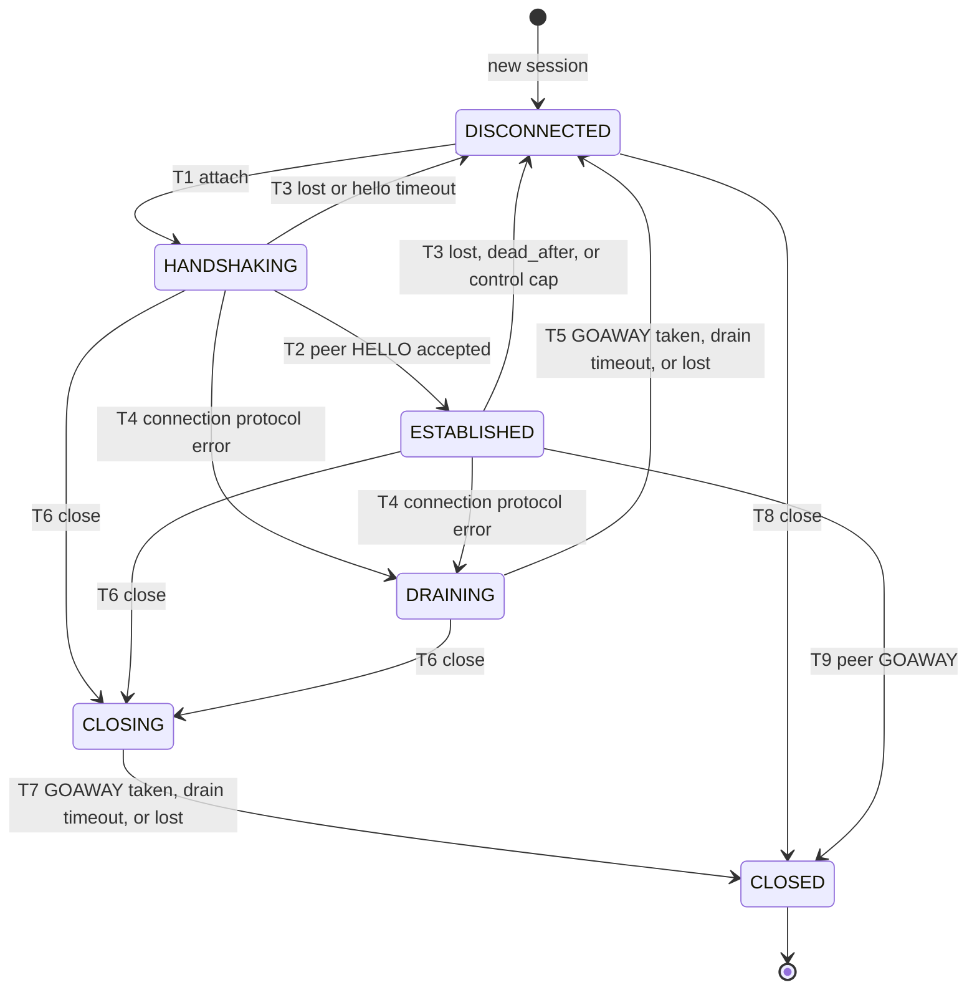
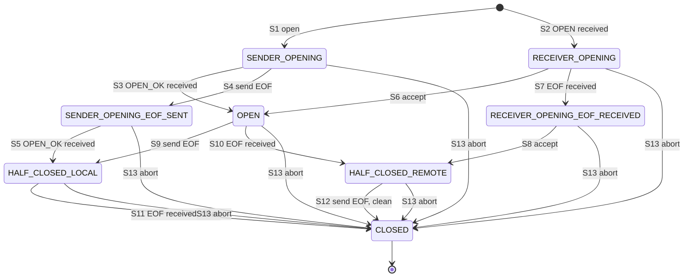

# PacketMux protocol specification

Protocol version: **2**. Status: authoritative.

This document defines what goes on the wire and how a session and its streams behave, so that the
protocol can be implemented from it alone. If an implementation disagrees with this document, one of
them has a bug: settle it and record it in §11. Requirement IDs such as FR-STR-4 refer to
`docs/requirements/INTENT.md`, which says why each rule exists.

`conformance/` tests this document. The keywords MUST, MUST NOT, SHOULD and MAY are used as in RFC 2119.

## 1. Model

| Term | Meaning |
|---|---|
| Transport | One connection that delivers whole messages, reliably and in order |
| Message | One unit on the transport. One message carries exactly one frame |
| Session | Persistent state shared by two peers. It owns the streams and outlives transports |
| Connection | A session bound to one live transport. A session has at most one |
| Stream | One bidirectional, ordered byte stream inside a session |
| Client, server | Roles. They decide stream ID parity, and otherwise the protocol is symmetric |

A session is sans-I/O: the host feeds it messages and the time, and takes out frames and events.
Streams do not survive a connection: when it ends, they end with `TRANSPORT_LOST`. The session
survives, and a client may reconnect to it (§6).

## 2. Frames

### 2.1 Conventions

- All integers are unsigned and **big-endian**.
- `u8`, `u16`, `u32`, `u64` are 1, 2, 4 and 8 bytes.
- `id16` is a `u16` length plus that many identifier characters (§2.5). The length MUST be at least 1.
- `bytes32` is a `u32` length plus that many opaque bytes. The length MAY be 0. Implementations MUST
  NOT interpret them.
- A payload MUST end exactly after its last field. Bytes left over are an error.
- Layouts are fixed: every field is present, in order, with no tags.

### 2.2 Header

```
offset  size  field
0       1     type        u8  (§2.3)
1       4     stream_id   u32
5       ...   payload     (rest of the message)
```

The header is 5 bytes. There is no length field: one transport message is one frame.

### 2.3 Frame types

| Value | Name | stream_id | Payload |
|---|---|---|---|
| 1 | `HELLO` | 0 | `version u16 \| resuming u8 \| receive_window u32 \| session_id id16 \| capabilities bytes32` |
| 2 | `OPEN` | ≠ 0 | `kind id16 \| params bytes32` |
| 3 | `OPEN_OK` | ≠ 0 | empty |
| 4 | `OPEN_ERR` | ≠ 0 | `code u8 \| message bytes32` |
| 5 | `DATA` | ≠ 0 | raw bytes, length 1 to `max_data_payload` |
| 6 | `EOF` | ≠ 0 | empty |
| 7 | `RST` | ≠ 0 | `code u8` |
| 8 | `PING` | 0 | `nonce u64` |
| 9 | `PONG` | 0 | `nonce u64` |
| 10 | `GOAWAY` | 0 | `code u8` |
| 11 | `WINDOW` | ≠ 0 | `credit u32` |

- Value 0 is never valid. Values are never renumbered, and new ones are only appended.
- `HELLO`, `OPEN` and `OPEN_ERR` payloads are each at most `max_control_payload`.
- **`HELLO.version` stays at payload offset 0 in every future protocol version.** A peer can then
  always read another version and reject it cleanly, even if the rest of the layout changes.
- `HELLO.resuming` is 0 or 1 (§6.2).
- `HELLO.receive_window` is at least 2, and `WINDOW.credit` is at least 1 (§8.1).
- An empty `DATA` is invalid.

### 2.4 Reason codes

| Value | Name | Notes |
|---|---|---|
| 0 | `OK` | |
| 1 | `PEER_CLOSED` | |
| 2 | `CONNECT_FAILED` | |
| 3 | `POLICY_DENIED` | |
| 4 | `LIMIT_EXCEEDED` | |
| 5 | `TRANSPORT_LOST` | Local only. MUST NOT be sent |
| 6 | `KILLED` | |
| 7 | `AUTH_REVOKED` | |
| 8 | `TIMEOUT` | |
| 9 | `PROTOCOL_ERROR` | |
| 10 | `UNSUPPORTED_KIND` | |
| 11 | `SESSION_NOT_FOUND` | The server has no session for a resuming client (§6.3) |

On decode, a code of 12 or above, or `TRANSPORT_LOST`, becomes `PROTOCOL_ERROR`. The frame itself is
still valid. An encoder MUST refuse `TRANSPORT_LOST` and unknown values.

### 2.5 Identifiers

`kind` and `session_id` are identifiers. Every byte MUST be one of the ASCII characters `a-z`, `A-Z`,
`0-9` or `-`. Encoders refuse anything else, and decoders reject it.

### 2.6 Examples

```
HELLO    session "s1", new, no capabilities
         01 00000000 | 0002 | 00 | 00040000 | 0002 7331 | 00000000
HELLO    session "s1", resuming
         01 00000000 | 0002 | 01 | 00040000 | 0002 7331 | 00000000
OPEN     stream 1, kind "tcp-forward", params "{}"
         02 00000001 | 000b 7463702d666f7277617264 | 00000002 7b7d
OPEN_OK  03 00000001
OPEN_ERR stream 1, POLICY_DENIED, message "no"
         04 00000001 | 03 | 00000002 6e6f
DATA     stream 3, "hi"
         05 00000003 | 6869
EOF      06 00000003
RST      stream 3, KILLED
         07 00000003 | 06
PING     nonce 1
         08 00000000 | 0000000000000001
PONG     09 00000000 | 0000000000000001
GOAWAY   AUTH_REVOKED
         0a 00000000 | 07
WINDOW   stream 3, 128 KiB
         0b 00000003 | 00020000
```

## 3. Decoding

Checks run **in this order**, and the first failure decides the status. The order is fixed so that
an input with several faults always gives the same result.

| # | Check | Status on failure |
|---|---|---|
| 1 | The message is at least 5 bytes | `TRUNCATED` |
| 2 | The type is 1 to 10 | `UNKNOWN_TYPE` |
| 3 | stream_id is 0 for `HELLO`, `PING`, `PONG`, `GOAWAY`, and not 0 otherwise | `BAD_STREAM_ID` |
| 4 | The payload is within its limit | `PAYLOAD_TOO_LARGE` |
| 5 | Fixed sizes: `OPEN_OK` and `EOF` 0, `RST` and `GOAWAY` 1, `PING` and `PONG` 8, `DATA` at least 1 | `BAD_PAYLOAD_SIZE` |
| 6 | Fields, left to right. `HELLO`: version is read first and must be 2 | `UNSUPPORTED_VERSION` |
| 7 | A field or length prefix runs past the end | `TRUNCATED` |
| 8 | `HELLO.resuming` is 0 or 1 | `BAD_FLAG` |
| 9 | `HELLO.receive_window` is at least 2, and `WINDOW.credit` is at least 1 | `BAD_WINDOW` |
| 9 | An `id16` is empty, or has a character outside §2.5 | `BAD_IDENTIFIER` |
| 10 | Bytes are left after the last field | `BAD_PAYLOAD_SIZE` |

Steps 6 to 10 are one left-to-right pass: the first field that fails decides the status.

Compare a length with the bytes remaining. Never add it to an offset: a hostile `u32` length must not
overflow, including on 32-bit targets.

## 4. Session

### 4.1 States



| State | Meaning | Open a stream | Inbound messages |
|---|---|---|---|
| `DISCONNECTED` | No connection. A normal resting state. Session data and the stream ID counter are kept | Refused | Refused |
| `HANDSHAKING` | Our `HELLO` is queued. Waiting for the peer's | Allowed, pipelined after `HELLO` | Only `HELLO` is valid |
| `ESTABLISHED` | Normal operation. Keepalive runs | Allowed | Dispatched |
| `DRAINING` | The connection failed. Waiting for `GOAWAY` to be taken | Refused | Ignored |
| `CLOSING` | The session is ending. Waiting for `GOAWAY` to be taken | Refused | Ignored |
| `CLOSED` | Final | Refused | Refused |

### 4.2 Transition table

"→ X" moves to state X. A status name is what the host gets back, and nothing else happens. `-`
means nothing happens.

| State | attach | message | connection lost | tick | close | open stream | frames all taken |
|---|---|---|---|---|---|---|---|
| `DISCONNECTED` | → `HANDSHAKING` | `NOT_CONNECTED` | - | - | → `CLOSED` | `NOT_CONNECTED` | - |
| `HANDSHAKING` | `ALREADY_CONNECTED` | → `ESTABLISHED`, or → `DRAINING` | → `DISCONNECTED` | timeout → `DISCONNECTED` | → `CLOSING` | Opens | - |
| `ESTABLISHED` | `ALREADY_CONNECTED` | Dispatch, or → `DRAINING`, `DISCONNECTED`, `CLOSED` | → `DISCONNECTED` | Ping, or dead → `DISCONNECTED` | → `CLOSING` | Opens | - |
| `DRAINING` | `ALREADY_CONNECTED` | Ignored | → `DISCONNECTED` | timeout → `DISCONNECTED` | → `CLOSING` | `NOT_CONNECTED` | → `DISCONNECTED` |
| `CLOSING` | `CLOSED` | Ignored | → `CLOSED` | timeout → `CLOSED` | `CLOSED` | `CLOSED` | → `CLOSED` |
| `CLOSED` | `CLOSED` | `CLOSED` | - | - | `CLOSED` | `CLOSED` | - |

Reporting a lost connection is always safe: it does nothing once the connection has ended, so a host
never has to track who ended it.

### 4.3 Rules

- A session reaches `DISCONNECTED` or `CLOSED` with no streams and empty queues.
- The host sees exactly one `DISCONNECTED` or `SESSION_CLOSED` event for each attached connection.
- The session never closes the transport. Those two events are the host's signal to do it.
- `SESSION_CLOSED` and `DISCONNECTED` fire when `GOAWAY` is **taken**, which is before it is on the
  wire. The host MUST finish sending before it closes the transport.
- **Close (T6):** queues `GOAWAY(code)`, ends every stream with that code (`OK` is reported to streams
  as `PEER_CLOSED`), drops queued stream data, and refuses new streams. It finishes when `GOAWAY` is
  taken, or after `drain_timeout`.
- **Peer `GOAWAY` (T9):** ends every stream with that code (`OK` becomes `PEER_CLOSED`), and closes
  the session.
- **Lost connection (T3):** ends every stream with `TRANSPORT_LOST`.

### 4.4 Errors

A **connection** error (T4) is any of: a message that fails decoding (§3), a frame other than `HELLO`
during the handshake, a second `HELLO`, a wrong protocol version, or an `OPEN` that breaks §5.1. The
session ends all streams with `TRANSPORT_LOST`, drops their queues, queues `GOAWAY(PROTOCOL_ERROR)`,
and then disconnects when `GOAWAY` is taken, or after `drain_timeout`.

A **stream** error resets only that stream: `RST(PROTOCOL_ERROR)` is sent and the stream closes with
`PROTOCOL_ERROR`. This covers every frame marked `·` in §5.3.

Frames for an unknown or closed stream are ignored. Late frames are normal after a reset.

## 5. Streams

### 5.1 IDs

- IDs are `u32`. The client allocates odd IDs and the server even IDs. 0 is the connection.
- Within a session, IDs increase and are never reused, including across reconnects. When they run
  out, opening a stream fails locally.
- An `OPEN` with the wrong parity, or an ID not above the highest the peer has used, is a connection
  error. This also covers an ID already in use.

### 5.2 States

The **sender** is the side that sent `OPEN`, and the **receiver** is the side that received it.

| State | Meaning |
|---|---|
| `SENDER_OPENING` | We sent `OPEN` and wait for `OPEN_OK` or `OPEN_ERR`. We may pipeline `DATA` |
| `SENDER_OPENING_EOF_SENT` | As above, and we also sent `EOF` |
| `RECEIVER_OPENING` | The peer sent `OPEN` and the host has not answered. Inbound `DATA` is delivered |
| `RECEIVER_OPENING_EOF_RECEIVED` | As above, and the peer also sent `EOF` |
| `OPEN` | Accepted. Both directions are open |
| `HALF_CLOSED_LOCAL` | Accepted. We sent `EOF` |
| `HALF_CLOSED_REMOTE` | Accepted. The peer sent `EOF` |
| `CLOSED` | Over. The stream leaves the registry, and `STREAM_CLOSED` is emitted |



### 5.3 Transition table

Each cell is the next state. `=` means the state does not change. `·` means the input is invalid.

| State | `OPEN_OK` rx | `OPEN_ERR` rx | `DATA` rx | `EOF` rx | `RST` rx | accept | reject | write | send EOF | reset |
|---|---|---|---|---|---|---|---|---|---|---|
| `SENDER_OPENING` | `OPEN` | `CLOSED` | · | · | `CLOSED` | · | · | = | `SENDER_OPENING_EOF_SENT` | `CLOSED` |
| `SENDER_OPENING_EOF_SENT` | `HALF_CLOSED_LOCAL` | `CLOSED` | · | · | `CLOSED` | · | · | · | · | `CLOSED` |
| `RECEIVER_OPENING` | · | · | = | `RECEIVER_OPENING_EOF_RECEIVED` | `CLOSED` | `OPEN` | `CLOSED` | · | · | `CLOSED` |
| `RECEIVER_OPENING_EOF_RECEIVED` | · | · | · | · | `CLOSED` | `HALF_CLOSED_REMOTE` | `CLOSED` | · | · | `CLOSED` |
| `OPEN` | · | · | = | `HALF_CLOSED_REMOTE` | `CLOSED` | · | · | = | `HALF_CLOSED_LOCAL` | `CLOSED` |
| `HALF_CLOSED_LOCAL` | · | · | = | `CLOSED` | `CLOSED` | · | · | · | · | `CLOSED` |
| `HALF_CLOSED_REMOTE` | · | · | · | · | `CLOSED` | · | · | = | `CLOSED` | `CLOSED` |

- An invalid **frame** is a stream error (§4.4): the stream is reset, and closes with `PROTOCOL_ERROR`.
- An invalid **host call** returns `INVALID_STATE`, sends nothing, and changes nothing.
- `DATA` and `EOF` are invalid in the sender rows, because the receiver cannot write before it
  accepts, and `OPEN_OK` goes out first.

### 5.4 Closing

S13 covers every unclean end, with the reason the host sees in `STREAM_CLOSED`:

| Cause | Reason |
|---|---|
| `RST` received | The received code (`OK` becomes `PEER_CLOSED`) |
| Host reset | Its code (`OK` becomes `PEER_CLOSED`) |
| `OPEN_ERR` received | The received code |
| Host reject | Its code |
| A frame invalid for the stream's state | `PROTOCOL_ERROR` |
| The connection ends | `TRANSPORT_LOST` |
| The session ends | The session's code (`OK` becomes `PEER_CLOSED`) |

So `STREAM_CLOSED` carries `OK` only for a clean close (S11, S12). Every stream gets exactly one
`STREAM_CLOSED`.

A clean close does not drop queued `DATA` or `EOF`: they still go out, so `STREAM_CLOSED` can come
before our last byte reaches the wire. An abort discards them.

### 5.5 Opening

- The sender MAY send `DATA` and `EOF` before `OPEN_OK` (pipelining). `OPEN` always reaches the wire
  first.
- An inbound `OPEN` is reported to the host, which accepts or rejects it. Over `max_streams`, the
  session rejects it by itself with `LIMIT_EXCEEDED`.
- `DATA` and `EOF` received before the host answers are delivered, in order, after the open event.
  After a reject, later frames for the stream are dropped silently.

## 6. Handshake and reconnect

### 6.1 Handshake

Each peer MUST send `HELLO` as its first frame on a new connection, in both directions. Any other
frame first, or a second `HELLO`, is a connection error. If no `HELLO` arrives within `hello_timeout`,
the connection is lost with `TIMEOUT`.

The session ID and capabilities of the peer are handed to the host, which decides whether they are
acceptable. The protocol does not authenticate.

### 6.2 `resuming`

`resuming` is false until a session has finished a handshake once, and true on every connection after
that. The implementation sets it, not the host. A retry after a handshake that never finished is
still not resuming.

### 6.3 Reconnecting

A client reconnects by attaching a new connection to the same session, with the same session ID. A
server looks the session up by the ID in the client's first `HELLO`:

| The server has the session | `resuming` | Result |
|---|---|---|
| Yes | Either | Attach, replacing any live connection |
| No | False | Create the session |
| No | True | Do not create one. Answer `HELLO`, then `GOAWAY(SESSION_NOT_FOUND)`, and close |

`HELLO` has to go first, by §6.1. The client's session closes with `SESSION_NOT_FOUND`. A new session
has a new ID. A server never recreates a session under an ID that a client is resuming, so stream ID
state (§5.1) always matches a real peer.

A session ID belongs to one session object. A peer that restarts needs a new ID.

## 7. Keepalive

- A peer MUST send `PING` every `ping_interval` while `ESTABLISHED`, with a nonce of its choice.
- On `PING`, a peer MUST answer `PONG` with the same nonce.
- A `PONG` matching an outstanding `PING` gives the RTT. Other `PONG`s are ignored. At most
  `max_outstanding_pings` are tracked.
- If no frame of any type arrives for `dead_after`, the connection is lost with `TIMEOUT`.

## 8. Scheduling and queues

- Control frames (`HELLO`, `OPEN`, `OPEN_OK`, `OPEN_ERR`, `RST`, `PING`, `PONG`, `GOAWAY`, `WINDOW`) go
  before stream data, in the order they were queued.
- `DATA` and `EOF` use one queue per stream, so `EOF` never overtakes its data.
- Streams with queued data and enough credit are served round-robin, one frame per turn.
- Writes larger than `max_data_payload` are split.
- Frames are pulled one at a time, so a host can stop while its transport is backed up.

Queued data is bounded per stream by `max_queued_bytes_per_stream`, and per session by
`max_queued_bytes`. A write that does not fit is partly or wholly refused, and the host is told how
much was accepted. After a refusal, a `WRITABLE` event says when that stream has room, including when
another stream's queue is dropped.

Control frames do not count towards these limits. They are bounded by `max_queued_control_frames`,
checked after each inbound message. Going past it ends the connection with `LIMIT_EXCEEDED`. A
configuration whose cap is not above 5 × `max_streams` is refused.

There is no receive buffer in the session. Inbound `DATA` goes to the host as it arrives, and credit
bounds what the host can be holding.

### 8.1 Flow control

Each side announces `receive_window` in `HELLO`, for all its streams on that connection. It is fixed
until the next `HELLO`.

**Sending.** A stream starts with credit equal to the peer's `receive_window`. Each `DATA` frame spends
its payload size. `EOF`, `RST` and control frames spend nothing. A stream whose next frame is larger
than its credit waits, and takes no turns. `EOF` stays behind its data. `WINDOW` adds `credit`.

`DATA` frames are at most half the peer's `receive_window`. A stream waiting for credit then has more
than half a window in flight or held by the receiver, so a grant always follows once the consumer has
read it.

Until the peer's `HELLO` arrives a stream can be opened, but a write accepts nothing. The stream gets
`WRITABLE` when the `HELLO` arrives.

**Receiving.** The host reports what its consumer has taken. Once that reaches half of
`receive_window`, the session sends all of it in one `WINDOW`. Bytes the host has not reported are never
granted. No `WINDOW` is sent after the peer's `EOF`.

**Errors.** `DATA` beyond the credit given, or `WINDOW` that takes credit above the peer's
`receive_window`, is a connection error with `PROTOCOL_ERROR`. `WINDOW` is not a stream state input:
it applies to a stream that still has data queued, including after a local close, and is otherwise
ignored.

A close does not wait for credit, as closing drops stream queues. Credit never crosses a reconnect,
because streams end with the connection.

## 9. Limits and defaults

| Parameter | Default |
|---|---|
| `max_data_payload` | 16 000 B |
| `max_control_payload` | 32 KiB |
| `max_streams` | 64 |
| `max_queued_bytes` | 16 MiB |
| `max_queued_bytes_per_stream` | 256 KiB |
| `receive_window` | 256 KiB |
| `max_queued_control_frames` | 1024 |
| `hello_timeout` | 10 s |
| `ping_interval` | 15 s |
| `dead_after` | 45 s |
| `drain_timeout` | 1 s |
| `max_outstanding_pings` | 8 |

## 10. Versioning

Each version stays minimal. Any wire change either raises the version or, before a version is
released, changes this document, the code and `conformance/` together. There is no in-band feature
negotiation. Peers of different versions do not interoperate: a `HELLO` with another version is a
connection error.

Version 2 is not released yet.

## 11. Resolved disagreements

| Date | Disagreement | Resolution |
|---|---|---|
| 2026-10-31 | `M2_SESSION_CORE.md` said an invalid frame does not change the stream's state. FR-ERR-2 and the code reset the stream | The stream is reset (§5.3). The design note was wrong |
| 2026-10-31 | The transition table had a lost connection return `NOT_CONNECTED` or `CLOSED` once the connection had ended, which broke every host loop that reported a close | It does nothing (§4.2) |
